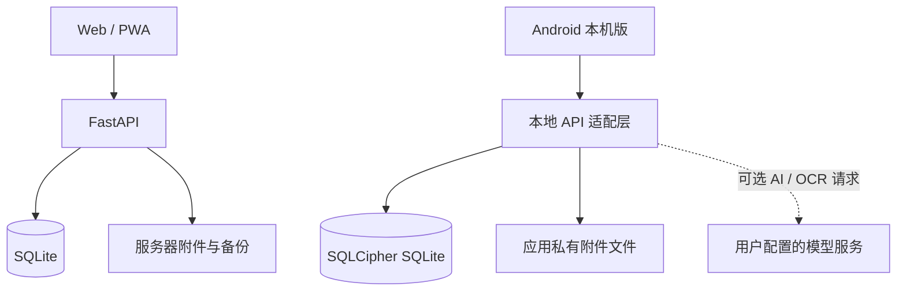

# 初记 · Student Growth OS

[](https://github.com/whalevoyage/chujiAPP1.0/actions/workflows/ci.yml)
[](LICENSE)

**从今天的计划，到大学几年的成长档案。**

初记把每日计划、任务执行、专注、日记、周期复盘、课表、成绩、项目与荣誉连接成一条个人成长轨迹。它支持 Web/PWA 自托管，也提供可独立使用的 Android 本机版。应用默认仅监听本机地址，不提供公开注册或社交功能；如需远程访问，请自行部署并配置 HTTPS。

## 成长闭环

```text
目标 → 计划 → 任务 → 专注 → 记录 → 复盘 → 改进 → 项目与荣誉 → 成长档案
```

## 架构



不开启 AI/OCR 时，Android 本机版的常规记录无需联网，也不需要远程 FastAPI 服务。启用 AI/OCR 后，相关复盘文字、成绩、课表图片和用户输入会发送到用户自行配置的模型服务。

## 功能

- 今日视图、每日计划、任务与打卡
- 日记、回忆图片墙、荣誉墙和问题记录
- 周/月复盘、成长评分与成绩分析
- 项目库、课表、专注计时和天气卡片
- 附件上传、数据导出、备份与恢复
- 管理员账户、删除确认和审计记录
- PWA 与 Capacitor Android 工程

## Android 手机本机版

Android 版可直接安装使用，不需要电脑、局域网或远程 FastAPI 服务器。首次打开会自动建立本机个人档案；结构化数据与本机备份元数据保存在 SQLCipher 加密 SQLite 数据库中，真实附件保存在应用私有文件目录。普通记录和附件可离线新增、查看、编辑和删除。

界面使用 Tailwind CSS v4，浏览器/WebView 需要 Chrome 或 Chromium 111+、Firefox 128+、Safari 16.4+。Android 本机版依赖系统 Android WebView，请先更新 WebView 再安装到较旧设备。

需要联网的可选功能包括 AI 复盘/成绩分析和课表照片 OCR。AI/OCR Key 可在手机内配置，模型请求从手机直接发送给你配置的服务商，不经过本项目服务器。手机本机版不请求实时天气服务，天气卡片显示离线状态；不开启模型服务不影响其他本机功能。

手机本机版支持导入初记 JSON 和完整 ZIP 备份。ZIP 中的附件也会一起导入；旧版服务器 JSON 不含附件原文件。导出通过 Android 分享面板保存或发送文件。卸载应用会清除手机内的数据；更换手机或卸载前请先导出 JSON/ZIP。

构建 Android 调试安装包需要 Node.js、npm、JDK 21 和 Android SDK：

```powershell
cd frontend
npm ci
npm run build:apk
```

调试包位于 `frontend/android/app/build/outputs/apk/debug/app-debug.apk`。

构建正式签名 APK 前，先在本机创建并安全保管发布密钥：

```powershell
New-Item -ItemType Directory -Force "$env:USERPROFILE\.android" | Out-Null
keytool -genkeypair -v -keystore "$env:USERPROFILE\.android\chuji-release.p12" -storetype PKCS12 -alias chuji-release -keyalg RSA -keysize 3072 -validity 10000
```

按提示设置密码后，在 `$env:USERPROFILE\.android\chuji-release.properties` 保存 `CHUJI_RELEASE_STORE_FILE`、`CHUJI_RELEASE_STORE_PASSWORD`、`CHUJI_RELEASE_KEY_ALIAS` 和 `CHUJI_RELEASE_KEY_PASSWORD` 四项。此文件和 `.p12` 私钥只保存在本机，严禁提交到 GitHub；另做一份安全备份。仓库默认从该 properties 文件读取签名信息，也可用同名环境变量配置。

之后构建正式 APK：

```powershell
cd frontend
npm ci
npm run build:release
```

正式 APK 位于 `frontend/android/app/build/outputs/apk/release/app-release.apk`。Android `versionCode` 从 `VERSION` 自动生成，后续升级时请递增语义版本。GitHub Actions 可在推送 `v*` 标签时构建并发布 APK；需先在仓库 Actions secrets 配置 `ANDROID_RELEASE_KEYSTORE_B64`、`CHUJI_RELEASE_STORE_PASSWORD`、`CHUJI_RELEASE_KEY_ALIAS` 和 `CHUJI_RELEASE_KEY_PASSWORD`。`ANDROID_RELEASE_KEYSTORE_B64` 是 `.p12` 文件的 Base64 内容。调试版和正式版使用不同签名；从预览版迁移时请先导出 JSON/ZIP，再卸载预览版并导入备份。

## 技术栈

- 前端：React、TypeScript、Vite、Tailwind CSS、PWA
- 后端：Python、FastAPI、SQLModel
- 数据：SQLite，默认保存在 `data/personal_vault.db`
- 默认本地端口：前端 `127.0.0.1:8787`，后端 `127.0.0.1:8788`

## 本地运行

环境要求：Python 3.11+、Node.js 20.19+（或 22.12+）和 npm。

复制配置模板并设置自己的密码：

```powershell
Copy-Item .env.example .env
```

首次启动前，请在 `.env` 中设置 `INITIAL_ADMIN_PASSWORD` 和独立的 `INITIAL_DELETE_PASSWORD`。`SESSION_SECRET` 留空时会在本地生成。不要提交 `.env`、数据库、附件、导出或备份文件。

启动后端：

```powershell
cd backend
python -m venv .venv
.\.venv\Scriptsctivate
pip install -r requirements.lock
uvicorn app.main:app --host 127.0.0.1 --port 8788
```

启动前端：

```powershell
cd frontend
npm ci
npm run dev
```

浏览器打开 <http://127.0.0.1:8787>。

## 构建

构建 PWA：

```powershell
cd frontend
npm ci
npm run build
```

构建独立手机本机版不需要配置服务器地址：

```powershell
cd frontend
npm ci
npm run build:apk
```

若需要将 Android 壳连接到自托管服务器，才配置 `CAPACITOR_SERVER_URL` 为 HTTPS 地址。网页/PWA 远程模式可使用 `VITE_SERVER_URL`。`build:apk` 当前生成 Android 调试包，不是应用商店发布包。

## 部署与隐私

- 数据库、附件、导出和备份保存在运行应用的机器上。
- 后端默认绑定 `127.0.0.1`；公网访问应通过配置了 HTTPS 的反向代理。
- 自托管模式需要在自己的 `.env` 中配置服务密钥。手机本机版的 AI/OCR Key 保存在手机加密数据库中；调用时，相应提示和数据会发送给你配置的模型服务提供方。
- 上传和备份内容可能包含个人资料；请妥善保管数据目录与备份文件。

详细部署说明见 [DEPLOY.md](DEPLOY.md)。

开发与贡献方式见 [CONTRIBUTING.md](CONTRIBUTING.md)，漏洞报告方式见 [SECURITY.md](SECURITY.md)，版本变更见 [CHANGELOG.md](CHANGELOG.md)。

## 许可证

本项目以 MIT License 发布，详见 [LICENSE](LICENSE)。第三方依赖仍适用各自的许可证，见 `frontend/package.json`、`frontend/package-lock.json`、`backend/requirements.txt` 和锁定文件。

