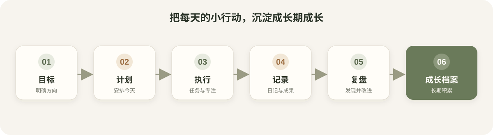
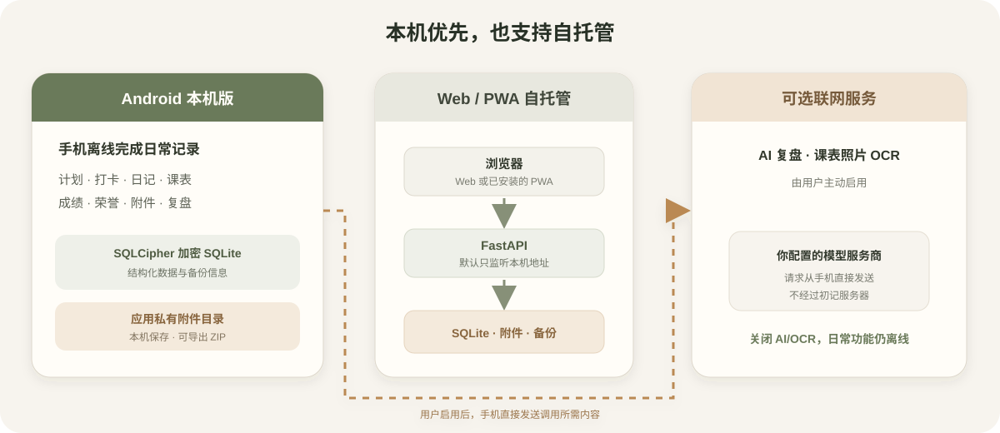

<div align="center">
  
  <h1>初记 · Student Growth OS</h1>
  <p><strong>从今天的计划，到大学几年的成长档案。</strong></p>
  <p>
    <a href="https://github.com/whalevoyage/chujiAPP1.0/releases/latest">Android 稳定版下载</a>
    · <a href="DEPLOY.md">自托管部署</a>
    · <a href="CONTRIBUTING.md">参与贡献</a>
  </p>
  <p>
    <a href="https://github.com/whalevoyage/chujiAPP1.0/actions/workflows/ci.yml"></a>
    
    <a href="https://github.com/whalevoyage/chujiAPP1.0/releases/latest"></a>
  </p>
</div>

初记把目标、计划、任务、记录、复盘和成果连接成个人成长轨迹。项目提供可离线使用的 Android 本机版，也支持 Web/PWA 自托管。

## 项目图片





## 功能

- 今日安排、计划、任务打卡和专注计时
- 日记、回忆图片、问题记录和周期复盘
- 课表、成绩、项目、荣誉和附件管理
- JSON/ZIP 数据导入导出，ZIP 会包含附件
- Android 本机版使用 SQLCipher 加密数据库和应用私有附件目录
- Web/PWA 模式通过 FastAPI 自托管，默认只监听本机地址

## Android 本机版

[下载最新 Android 稳定版 APK](https://github.com/whalevoyage/chujiAPP1.0/releases/latest)。首次打开会在手机创建本机档案；常规记录和附件可离线使用，不需要电脑、远程服务器或账号注册。

AI 复盘和课表照片 OCR 是可选联网功能。启用时，相关内容由手机直接发送到你配置的模型服务商，不经过初记服务器。未启用模型服务不影响其它本机功能。

卸载应用会清除本机数据。更换手机或卸载前，请在“我的 → 数据备份”导出 JSON/ZIP。早期预览版与稳定版签名不同；从预览版迁移时，先备份、卸载预览版，再安装稳定版并导入备份。

Tailwind CSS v4 要求 Chrome/Chromium 111+、Firefox 128+ 或 Safari 16.4+。Android 本机版使用系统 WebView；较旧设备请先更新 Android System WebView。

## 本地运行 Web/PWA

环境要求：Python 3.11+、Node.js 20.19+ 或 22.12+、npm。

```powershell
Copy-Item .env.example .env
```

在 `.env` 中设置 `INITIAL_ADMIN_PASSWORD` 和独立的 `INITIAL_DELETE_PASSWORD`，再启动后端：

```powershell
cd backend
python -m venv .venv
.\.venv\Scripts\Activate.ps1
pip install -r requirements.lock
uvicorn app.main:app --host 127.0.0.1 --port 8788
```

另开终端启动前端：

```powershell
cd frontend
npm ci
npm run dev
```

浏览器打开 <http://127.0.0.1:8787>。本地数据库、附件和备份保存在运行应用的机器上；公网访问需要自行配置 HTTPS 反向代理。

## 构建 Android

```powershell
cd frontend
npm ci
npm run build:apk
```

调试 APK 输出到 `frontend/android/app/build/outputs/apk/debug/app-debug.apk`。构建 Android 需要 JDK 21 和 Android SDK。

正式签名构建使用长期保管的密钥。首次创建密钥：

```powershell
New-Item -ItemType Directory -Force "$env:USERPROFILE\.android" | Out-Null
keytool -genkeypair -v -keystore "$env:USERPROFILE\.android\chuji-release.p12" -storetype PKCS12 -alias chuji-release -keyalg RSA -keysize 3072 -validity 10000
```

随后在 `$env:USERPROFILE\.android\chuji-release.properties` 保存签名配置：

```properties
CHUJI_RELEASE_STORE_FILE=C:/Users/<用户名>/.android/chuji-release.p12
CHUJI_RELEASE_STORE_PASSWORD=<创建密钥时设置的密码>
CHUJI_RELEASE_KEY_ALIAS=chuji-release
CHUJI_RELEASE_KEY_PASSWORD=<密钥密码>
```

密钥文件和 properties 文件必须保存在仓库外并另做安全备份。正式 APK 输出到 `frontend/android/app/build/outputs/apk/release/app-release.apk`。GitHub Release 工作流使用 Actions Secrets `ANDROID_RELEASE_KEYSTORE_B64`、`CHUJI_RELEASE_STORE_PASSWORD`、`CHUJI_RELEASE_KEY_ALIAS` 和 `CHUJI_RELEASE_KEY_PASSWORD` 签名，并发布 APK 与 SHA-256 校验文件。后续升级请递增根目录 `VERSION`，Android `versionCode` 会按该版本自动生成。

## 自托管部署

后端默认绑定 `127.0.0.1`，不提供公开注册或社交功能。部署、HTTPS 和备份说明见 [DEPLOY.md](DEPLOY.md)。本地数据与模型服务的隐私边界见 [SECURITY.md](SECURITY.md)。

## 开发与许可

技术栈：React、TypeScript、Vite、Tailwind CSS、Capacitor、FastAPI、SQLModel 和 SQLite。贡献流程见 [CONTRIBUTING.md](CONTRIBUTING.md)，变更记录见 [CHANGELOG.md](CHANGELOG.md)。本项目采用 MIT License，详见 [LICENSE](LICENSE)。
